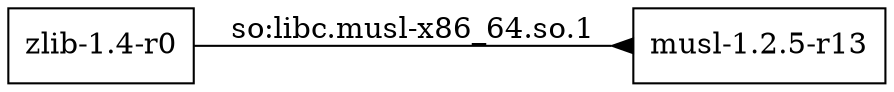
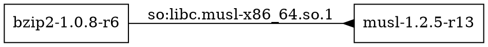
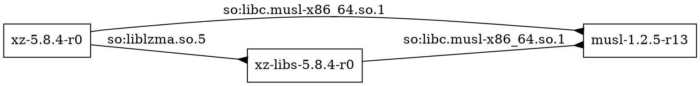

# Сравнение с apk dot

Среда: Windows, Git Bash, Ubuntu через WSL 2.
Штатный инструмент: apk-tools 2.14.13.
Архитектура: x86_64.
Репозиторий: Alpine v3.22, main.

Дата: 2026-11-07T13:16:52+03:00

Источник индекса:
https://dl-cdn.alpinelinux.org/alpine/v3.22/main/x86_64/APKINDEX.tar.gz

SHA-256 использованного архива:
`70f0461551af9cf15b0f9b938240cb50dc5975091a7b4820269a12564c463414`

Оба инструмента сравниваются на одной сохранённой копии индекса.
В штатном выводе имена с версиями сопоставлены с именами пакетов.
Сравниваются множества направленных рёбер.

## zlib

Версия пакета: `1.4-r0`.

Связи нашей программы:
```text
zlib -> musl
```

Штатный вывод apk dot:


**Результат: Совпало.**

## bzip2

Версия пакета: `1.0.8-r6`.

Связи нашей программы:
```text
bzip2 -> musl
```

Штатный вывод apk dot:


**Результат: Совпало.**

## xz

Версия пакета: `5.8.4-r0`.

Связи нашей программы:
```text
xz -> musl
xz -> xz-libs
xz-libs -> musl
```

Штатный вывод apk dot:


**Результат: Совпало.**

## Вывод

Для всех трёх пакетов множества рёбер совпали.
Различаются формат диаграмм и оформление подписей:
наша программа формирует PlantUML и SVG, apk dot — Graphviz DOT.
Штатный вывод дополнительно содержит версии пакетов
и требования к библиотекам в подписях рёбер.

Совпадение проверено для выбранных примеров.
Учебная программа не реализует полный решатель версий apk.
